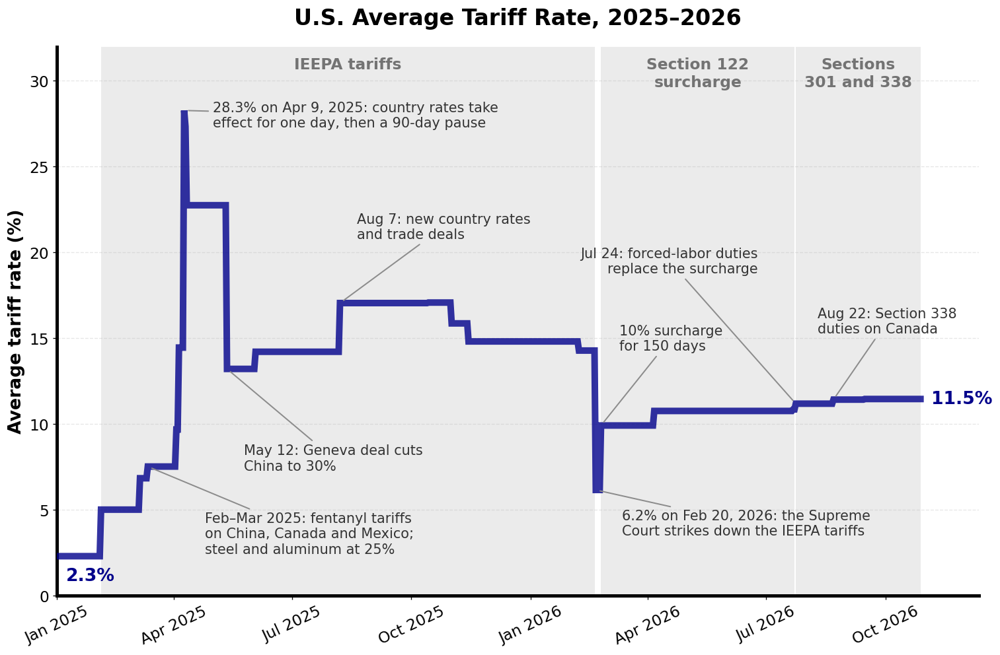

## trade-war-redux-2025

  

Updated: 2026-10-26

This repository tracks U.S. tariff changes and produces data + charts used in the public tracker.

## Primary workflow

1. [make-tariff-by-country-by-time.ipynb](make-tariff-by-country-by-time.ipynb)
   - Builds country/time tariff panel data.
   - Writes [country-by-time.csv](country-by-time.csv) and [daily-tariff-latest-data.csv](daily-tariff-latest-data.csv).

2. [plot-tariff-by-country-by-time.ipynb](plot-tariff-by-country-by-time.ipynb)
   - Reads the latest output files and produces website charts/tabs.
   - Uses [federal-tax-duty.csv](federal-tax-duty.csv) and [NIPA-imports.csv](NIPA-imports.csv) for historical tariff calculations.

3. [get-country-hs2-tariff.ipynb](get-country-hs2-tariff.ipynb)
   - Generates country-by-HS2 tariff outputs in [data-hs2](data-hs2).

## Standalone analysis notebooks

4. [revenue-analysis.ipynb](revenue-analysis.ipynb)
   - Estimates 2025 tariff revenue using Census import data and the tariff engine.
   - Self-contained: includes its own copy of the tariff engine pipeline (masks, apply functions, action registry).

5. [section-122-analysis.ipynb](section-122-analysis.ipynb)
   - Analyzes Section 122 surcharge exemption coverage and the pre/post SCOTUS tariff shift.
   - Reads [country-by-time.csv](country-by-time.csv) from the main notebook; must be run after (1).

6. [brazil-301-analysis.ipynb](brazil-301-analysis.ipynb)
   - Tariff impact and exemption coverage for the Jul 22, 2026 Brazil Section 301 action.
   - Writes figures to [figures](figures); must be run after (1).
   - Imports the tariff engine directly from the main notebook (executes its code cells
     up to `tariff_imports`), so it holds no duplicate copy of the masks or registry.

7. [canada-338-analysis.ipynb](canada-338-analysis.ipynb)
   - Coverage, incidence and rate impact of the three Aug 22, 2026 Section 338 actions (originally Aug 19)
     on Canada: what is hit, what is not, top products, and a decomposition of the
     +1.85pp rate step against the +2.49pp naive figure.
   - Quantifies the one real bias (the auto-parts list applied flat by HS code, ~0.19pp down) and shows
     why the chapter-44 wood in the basket is *not* a bias (hardwood/plywood, non-232).
   - Section 7 breaks down the Sep 15, 2026 amendment. Dropping the Section 232 carve-out
     for alcohol and autos adds 0.31pp to Canada's rate, from switchgear already in the
     basket and from steel and aluminum structures added that day; the basket reshuffle
     alone is −0.03pp. The section lists the products that now pay both duties.
   - Section 8 covers Oct 30: which goods' tariffs fell and which are new.
   - Writes figures to [figures](figures); must be run after (1).
   - Imports the tariff engine from the main notebook, same as (6).

8. [section122-to-301labor-transition.ipynb](section122-to-301labor-transition.ipynb)
   - Compares three scenarios across the Section 122 surcharge's July 24, 2026 expiry:
     the surcharge in force, the gap if nothing replaces it, and the **provisional**
     Section 301 forced-labor action taking its place. Uses the main notebook's engine and
     2024 weights; activates the staged-off labor regime by hand for the third scenario.
   - Finding: in aggregate the labor duty **more than** replaces the surcharge (national
     average ~10.8% → ~11.7%, a net +0.9pp, via a ~7.6% gap — national figures include the
     +2.3pp MFN baseline to match the tracker), because it charges 12.5% where the surcharge
     charged 10%. It also redistributes sharply — 12.5%-tier countries pay more, while the
     10% tier, USMCA (Canada/Mexico), and the flat CAFTA-DR textile carve-out leave others
     lighter. Both regimes are compared on the same exemption basis (see the aircraft note
     in the forced-labor detail section). Note: this notebook models the **provisional**
     Jun 5 proposal; the final Notice of Action (now live) is lighter (national step +0.33pp,
     see the forced-labor detail) — a dedicated provisional-vs-final comparison is in (9).
   - Writes figures to [figures](figures); must be run after (1).

9. [section301-labor-overview.ipynb](section301-labor-overview.ipynb)
   - Overview of the **final, live** forced-labor action in two parts: (1) the Section 122
     → labor transition (national step **+0.33pp**, plus the supplier-level redistribution),
     and (2) the **proposal → final** change, decomposed into a **rate effect** (−0.26pp,
     six economies cut 12.5→10), a **net-of-MFN cap effect** (−0.18pp, EU, Taiwan, Japan and
     Switzerland) and an **exemption effect** (−0.09pp, the new 700-code pharma carve-out) —
     the final action is ~0.5pp lighter than the June 5 proposal (11.75% → 11.22%). Recomputes the
     provisional scenario in-engine (provisional rates + 1,098-code Annex A) alongside the
     live final series. Figures `figures/overview-*.png`.
   - Imports the tariff engine from the main notebook (1); must be run after it.

10. [china-30for30-analysis.ipynb](china-30for30-analysis.ipynb)
   - What happens to China's rate if the Sep 27, 2026 U.S.-China **"30-for-30"** U.S.
     import list is excluded from the 12.5% forced-labor Section 301 duty — the list's only
     modeled duty — i.e. returned to its 2024 tariff level. Coverage of the 77-code list
     (~$30B of 2024 imports, 6.9% of China's), the China step (**−0.86pp**, 11.94% → 11.07%),
     the national effect (**−0.12pp**), a product-group decomposition, and the legacy-301
     residual the list would still carry. The reduction is **announced, not enacted**; the
     notebook activates the staged-off regime by hand (see the announced-actions section).
   - Writes figures to [figures](figures); imports the engine from (1), must be run after it.

## Helper scripts

- [extract-301-exemptions.py](extract-301-exemptions.py)
  - Extracts the U.S. note exemption subdivisions from a USTR Section 301 Notice of
    Action PDF into a single CSV with a `category` column.
  - Asserts the expected per-category code counts and fails loudly on a mismatch —
    update the counts in `SUBDIVISIONS` for each new notice.
  - Usage: `python extract-301-exemptions.py <notice.pdf> <out.csv>`

- [extract-338-annex.py](extract-338-annex.py)
  - Extracts the target basket of each Section 338 proclamation, plus the shared
    civil-aircraft carve-out, into CSVs with `HTSUS` and `description` columns.
  - Cross-checks Annex I (descriptive) against Annex II (HTSUS legal text). The two
    restate the same codes, so disagreement means a bad parse. Unlike the hardcoded
    counts in the 301 script, this guard needs no per-notice maintenance.
  - Add a new action by appending to the `ACTIONS` table; no other change needed.
  - A later proclamation that amends a basket goes in the `AMENDMENTS` table. Its Annex II
    deletions and insertions are applied to the basket in force the day before, and the
    result is written as a dated version (e.g. `canada-338-autos-2026-10-30.csv`). Annex I
    is reconciled with Annex II allowing for narrowings, where Annex II deletes an HS8 line
    and re-inserts the HS10 lines that stay, while Annex I lists only the lines that leave.
    Amending annexes are read with pdfplumber, because pypdf scrambles the reading order of
    the Sep 8, 2026 autos Annex II.
  - Usage: `python extract-338-annex.py`

- [validate-338.py](validate-338.py)
  - Independent second opinion on the Section 338 lists: re-parses the annexes with a
    different method, checks the lists against observed trade data, and asserts the
    economic magnitudes quoted downstream so a silent list change cannot move the
    published numbers unnoticed.
  - Imports its config from `extract-338-annex.py` so the two cannot disagree.
  - For the dated versions it rebuilds each one from an order-free parse of its Annex II,
    and checks that:
    - every narrowing accounts for all HTS lines under the narrowed code;
    - the note 51(c) wording matches each regime's Section 232 setting;
    - the baskets in force on each date are disjoint;
    - every code banned on Sep 29, 2026 is already in a basket.
  - Usage: `python validate-338.py` (exits non-zero on failure)

- [validate-301-labor.py](validate-301-labor.py)
  - Guardrail for the **provisional** Section 301 forced-labor action. Baseline mode
    asserts the economy→tier table and the Annex A exemption list are internally
    consistent and — the load-bearing check — that Annex A is still bit-for-bit identical
    to the combined Section 122 exemption lists, which is why the notebook can reuse them.
  - Diff mode (`--diff-economies … --diff-exemptions …`) runs when the Notice of Action
    lands: it reports economies added/removed, per-economy rate changes, and Annex A code
    deltas against the committed provisional baseline, and re-checks the Section 122
    equality. It is the punch list for turning the provisional model into the real one.
  - Usage: `python validate-301-labor.py` (exits non-zero on failure)

- [extract-china-30for30.py](extract-china-30for30.py)
  - Extracts the U.S. import list of the Sep 27, 2026 U.S.-China "30-for-30" framework
    ([china-USimports-Public-List.pdf](tariff-lists/china-USimports-Public-List.pdf)) into
    [china-30for30-us-import-list.csv](tariff-lists/china-30for30-us-import-list.csv) (the
    77 HTS8 codes as printed, with the `Ex-Out` flag) and
    [china-30for30-model-list.csv](tariff-lists/china-30for30-model-list.csv) (the engine
    form: 70 HS8 codes plus the 13 HTS10 statistical lines that resolve the seven
    juvenile-furniture ex-outs to exactly the products their descriptions name).
  - Usage: `python extract-china-30for30.py`

- [validate-china-30for30.py](validate-china-30for30.py)
  - Guardrail for the 30-for-30 list, in the style of `validate-timber.py`: the raw list
    matches the PDF (77 codes, 8 ex-outs, valid HTS), the model list is the raw list with
    the juvenile ex-outs resolved (every resolved HTS10 label names a listed product), the
    resolved list covers **$29.6B** of 2024 China imports (the Terms of Reference say
    "roughly $30 billion" at 2024 values; the flat-HS8 figure is $32.5B), no listed code is
    in a modeled Section 232 list or an active labor Part A exemption (why reversing the
    labor duty nets the list to exactly zero), and the China step is −0.86pp.
  - Usage: `python validate-china-30for30.py` (exits non-zero on failure)

- [extract-china-30for30-exports.py](extract-china-30for30-exports.py)
  - The other half of the framework: extracts **China's** import list of US goods
    ([Usexports-China-Import-List.pdf](tariff-lists/Usexports-China-Import-List.pdf), Chinese
    only) into [china-30for30-china-import-list.csv](tariff-lists/china-30for30-china-import-list.csv)
    — 1,619 lines of China's 2026 tariff schedule (8 digits) in 51 chapters, 1,061 HS6. Chinese
    8-digit lines and US Schedule B agree only at HS6, so each HS6 carries a `match` score from
    the list's own structure (China's full schedule is not loaded): `whole` (a listed line is
    xxxxxx00, 742), `residual` (China splits the HS6 and its 90/99 "other" line is listed, 277)
    or `partial` (only some splits listed, 42 — US export data for these is a ceiling). Not
    modeled in the engine (it is a Chinese tariff); consumed by the trade-miner's
    `miner/china_30for30.py` cards. On US export statistics the list is **$25.0B** of 2024
    exports to China (17.5%), against the stated ~$30B — the gap is CIF/origin-based Chinese
    import statistics vs FAS US export statistics, not the HS6 match, which can only overstate.
    Notably absent: commercial soybeans (only seed soybeans 1201.10 are listed), crude oil, LPG,
    LNG, civil aircraft, semiconductors and passenger cars — the eight biggest US exports to China
    in 2024 are all off it.
  - Usage: `python extract-china-30for30-exports.py`

## Key folders

- [data](data): source and helper data files.
- [data-hs2](data-hs2): generated HS2 tariff output files.
- [docs](docs): rendered HTML/chart outputs.
- [tariff-lists](tariff-lists): input tariff schedule/list files.
- [old-data](old-data): archived historical datasets not used by the main notebooks.
- [old-code](old-code): archived notebooks and code no longer part of the main workflow.
- [old-files](old-files): prior archive folder kept for backward compatibility.

## Tariff events tracked in `make-tariff-by-country-by-time.ipynb`

The notebook encodes U.S. tariff policy changes in a structured `TARIFF_ACTIONS` registry applied chronologically. Each action carries its effective date, legal authority, executive order/proclamation reference, and a short description. Actions are split into three phases: **Phase 1** resets country-level base rates (IEEPA / Section 122 layer); **Phase 2** stamps sector-specific tariffs and product exemptions on top; **Phase 3** applies stacked country actions (Section 301 and Section 338), which *add* to the rate already in place rather than replacing it, and carve out goods already subject to Section 232.

### Phase 1 — Country-level base rates

| Date | Authority | Reference | Description |
|------|-----------|-----------|-------------|
| Feb 4, 2025 | IEEPA | EO 14193/14194/14195 | Fentanyl emergency: 20% on China and Hong Kong; Canada (EO 14193) and Mexico (EO 14194) also included but immediately paused |
| Mar 6, 2025 | IEEPA | Amendments to EO 14193/14194 | USMCA carve-out: Canada 8.75%, Mexico 4.5% |
| Apr 5, 2025 | IEEPA | EO 14257 | Reciprocal tariffs activate: 10% global baseline, country-specific rates from Annex I |
| Apr 8, 2025 | IEEPA | Amendment to EO 14257 | China/HK escalated to 84% reciprocal (+20% fentanyl = 104%) |
| Apr 9, 2025 | IEEPA | Amendment to EO 14257 | 90-day pause: all countries reset to 10%; China/HK raised to 125% |
| May 12, 2025 | IEEPA | U.S.-China Joint Statement (Geneva) | China/HK reciprocal from 125% to 10% (+20% fentanyl = 30%) |
| Aug 7, 2025 | IEEPA | EO 14326, EO 14323, EO 14325 | August country-specific rates from EO 14326; Brazil +40% (EO 14323); Canada fentanyl raised to 35% (EO 14325) |
| Nov 1, 2025 | IEEPA | EO 14358, EO 14357 | China 1-year truce: fentanyl reduced to 10% (net 20%); Canada rate scaled up |
| Nov 14, 2025 | IEEPA | U.S.-Switzerland Joint Statement | Switzerland rate capped at 15% |
| Dec 4, 2025 | IEEPA | ITA notice (90 FR 55964) | South Korea deal: 15% reciprocal ceiling |
| Feb 7, 2026 | IEEPA | EO suspending EO 14329; U.S.-India framework | India: Russian oil tariff removed, reciprocal reduced to 18% |
| Feb 20, 2026 | Executive Order | EO "Ending Certain Tariff Actions" | Supreme Court rules IEEPA does not authorize tariffs (*V.O.S. Selections v. United States*, 6-3); all IEEPA ad valorem duties revoked; Section 232 and 301 preserved; base rates zeroed |
| Feb 24, 2026 | Section 122 | Proclamation "Imposing a Temporary Import Surcharge" | 10% universal surcharge (150-day balance-of-payments emergency); Canada/Mexico USMCA-compliant goods exempt. Annex I terminates the surcharge *at* 12:01 a.m. Jul 24, so the last covered day is Jul 23 (`end_date`) |

### Phase 2 — Sector overrides and product exemptions

| Date | Authority | Reference | Description |
|------|-----------|-----------|-------------|
| Mar 12, 2025 | Section 232 | Proclamation 10895 (aluminum), 10896 (steel) | Steel and aluminum tariffs at 25% globally |
| Apr 3, 2025 | Section 232 | Proclamation 10908 | 25% tariff on automobiles and parts; Canada/Mexico treated as ~15% |
| Apr 11, 2025 | IEEPA | Amendment to EO 14257 | Consumer electronics (phones, laptops, etc.) exempt from reciprocal tariffs |
| Apr 11, 2025 | IEEPA | EO 14257 Annex II | Annex II product-level exemptions from reciprocal tariffs |
| Jun 3, 2025 | Section 232 | Proclamation 10947 | Steel and aluminum tariffs raised to 50%; UK remains at 25% per bilateral deal |
| Aug 7, 2025 | Section 232 / IEEPA | Proclamation 10962, Proc 10908 amendments, EO 14323 Annex | Copper at 50%; auto deal rates for Japan, EU, South Korea at 15%; Brazil-specific product exemptions |
| Oct 14, 2025 | Section 232 | Proclamation 10976 | Timber/lumber: softwood 10% (all countries); upholstered wooden furniture and completed kitchen cabinets/vanities 25% (UK 10%, Japan 15%, EU 15%). Steps up Jan 1 2027 — furniture 30%, cabinets 50% (registered, not surfaced in `date_strings`). Autos take precedence per clause 6 |
| Nov 14, 2025 | IEEPA | EO 14360 | Agricultural product exemptions; China phone fentanyl component reduced to 10% |
| Dec 4, 2025 | Section 232 | ITA notice (90 FR 55964) | South Korea auto deal at 15% |
| Feb 20, 2026 | Section 232 (surviving) | EO "Ending Certain Tariff Actions" — 232 preserved | Re-apply surviving 232 tariffs: steel/aluminum 50% (UK 25%), autos (25%, deal rates for UK/JP/EU/KR), copper 50% |
| Feb 24, 2026 | Section 122 | Proclamation Annex I, subdivision (aa)(ii) | Product exemptions from surcharge: energy (Ch. 27), critical minerals, pharma, ag, electronics, fertilizers, semiconductors, etc. (~1,098 HS codes) |
| Apr 6, 2026 | Section 232 | Proclamation "Strengthening Actions..." (Apr 2, 2026) | Metals tiered restructuring: Annex I-A 50% (UK 25%), Annex I-B 25% (UK 15%), Annex III ~15% temp (through 2027), Annex II exempt; Russian alu 200% |

### Phase 3 — Stacked country actions (Section 301, Section 338)

Phase 3 holds country-level actions that **add** to the rate already in place rather than replacing it, and that carve out goods already subject to Section 232. Both properties require them to run after Phase 2. Two legal authorities sit here, and both survived the Feb 20, 2026 SCOTUS ruling on IEEPA:

- **Section 301** (19 U.S.C. §§2411–20) — stacks per U.S. note 50(a)(i)
- **Section 338** (19 U.S.C. §1338) — stacks per U.S. note 51(a); a dormant 1930 retaliation provision authorizing duties of up to 50% against a country that discriminates against U.S. commerce

They differ in exactly one respect, captured by the `scope` field of `STACKED_REGIMES`: a 301 action covers **all** goods of a country except an exemption list, while a 338 action reaches only the codes **listed** in its annex. Every action in the phase is additive, so they commute and a country may carry several at once.

New actions are added declaratively — extract the code list, register it in Section 2, and append one entry to `STACKED_REGIMES`. No new logic is required.

An action that a later proclamation amends is split into dated versions. The existing entry gets an `end_date` (the last day it applies), and a new entry starts the next day with its own basket and carve-outs. Editing an entry in place would rewrite every earlier date in the panel.

| Date | Authority | Reference | Description |
|------|-----------|-----------|-------------|
| Jul 22, 2026 | Section 301 | USTR Notice of Action — Brazil (Jul 15, 2026) | 25% on all goods of Brazil; exemptions for 864 listed subheadings, 11 named articles, 546 civil-aircraft codes, 705 pharmaceutical-application codes, and all Section 232 sectors |
| Jul 31, 2026 | Section 301 | USTR Notice Annex I.B — U.S. note 50(a)(vi)(8) | Patented pharmaceuticals added to the Brazil 232 carve-out (no effect — sector not modeled) |
| Aug 22 – Sep 14, 2026 | Section 338 | Proclamation 11046 on Canadian alcoholic beverages (Jul 20, 2026), heading 9903.03.12; effective date amended by Proclamation 11056 | 50% on 63 enumerated Canadian codes (beverages, some wood and paper) |
| Aug 22, 2026 | Section 338 | Proclamation 11047 on Canadian dairy (Jul 20, 2026), heading 9903.03.13; effective date amended by Proclamation 11056 | 50% on 52 enumerated Canadian codes (milk products, sugars, caseins) |
| Aug 22 – Sep 14, 2026 | Section 338 | Proclamation 11048 on Canadian motor vehicles (Jul 20, 2026), heading 9903.03.14; effective date amended by Proclamation 11056 | 50% on 439 enumerated Canadian codes across 56 chapters |
| Aug 19–21, 2026 | Section 338 | Proclamation 11056 (Aug 18, 2026), FR Doc 2026‑17294 | 3‑day suspension of the three Canada actions during negotiations; Annex II chapeau of Procs 11046/11047/11048 amended from Aug 19 to Aug 22. Negotiations failed; duties took effect Aug 22 (no-op row — encoded as the regimes' effective date) |
| Sep 15, 2026 | Section 338 | Proclamation 11064 (Sep 8, 2026) modifying Proclamation 11046, heading 9903.03.12 | Alcohol basket −2 / +40 → 101 codes (cheese, hides, furskins, boats added; whisky and liqueurs over 4 liters leave). Now applies **in addition to** Section 232 |
| Sep 15 – Oct 29, 2026 | Section 338 | Proclamation 11065 (Sep 8, 2026) modifying Proclamation 11048, heading 9903.03.14 | Autos basket −8 / +82 → 513 codes (steel and aluminum structures, furniture, lamps, golf carts added; salt, cement, refined lead leave). Now applies **in addition to** Section 232 |
| Sep 29, 2026 | Section 338 | Proclamations 11061, 11062, 11063 (Sep 8, 2026) | Import bans on packaged beer, wine and spirits; whey, molasses and non-alcoholic beer; motorcycles over 800cc. Every banned code is already in a basket and is kept at the 50% basket rate (no-op row) |
| Oct 30, 2026 | Section 338 | Proclamation of Oct 23, 2026 further modifying Proclamation 11048, heading 9903.03.14 | Autos basket −22 / +100 → 591 codes (cocoa powder, paints, soaps, carpets, fiberboard, freezers, valves added; plywood, packaging and some machinery leave). Still in addition to Section 232 |
| Jul 24, 2026 | Section 301 | USTR Notice of Actions — forced labor (Docket USTR–2026–0265/0266, Jul 23 2026) | 12.5% (10% for 18 economies) on all goods of 50 tracked economies; Annex II Part A (unconditional + pharmaceutical codes) and all Section 232 sectors exempt. Effective the day the Section 122 surcharge lapses. See the forced-labor detail below. |

Because Section 122 runs through Jul 23 and the Brazil 301 action begins Jul 22, the two overlap for two days. All start and end dates are modeled literally, so Brazil shows a brief spike (≈17.5%) on Jul 22–23 before settling at ≈13.3%.

The three Section 338 actions (Proclamations 11046, 11047, 11048) were issued the same day against Canada, all at 50%, all originally effective Aug 19, 2026, and all sharing a single U.S. note 51. On Aug 18, Proclamation 11056 suspended them for three days while Canada negotiated on a "commitment to remove" the discriminations, moving the effective date to **Aug 22, 2026**; the talks failed and the duties took effect on that date. Nothing else in the three proclamations changed. Each retaliates for a distinct Canadian practice — provincial liquor-board bans, cheese TRQ allocation, and motor-vehicle tariffs and quotas — but the baskets deliberately target goods *other* than the offending sector, and are disjoint from one another. The civil-aircraft carve-out of note 51(d) (heading 9903.03.16, 554 codes) is enumerated once and shared by all three, so it is modeled as one exemption list referenced by three regimes. Neither the proclamations nor note 51 provide an in-transit grace window. Combined effect on Canada: **+1.85 pp** (5.82% → 7.66%), against +2.49 pp before carve-outs. (The 5.82%/7.66% levels sit ~0.18 pp above the pre-timber figures of 5.64%/7.49%, since the Section 232 timber action lifts Canada's whole curve from Oct 14 2025; the *step* is essentially unchanged.)

**Amendments.** Two later rounds changed the alcohol and autos baskets. Dairy was never amended.

- **Sep 15, 2026 (Procs 11064 and 11065, signed Sep 8).** Both baskets were reshuffled, and note 51(c) was rewritten so that its Section 232 exemption names only the dairy heading (9903.03.13). From Sep 15 the alcohol and autos duties apply *in addition to* Section 232.
- **Oct 30, 2026 (Proclamation of Oct 23, 2026; Federal Register number pending).** The autos basket changed again.
- **Sep 29, 2026 (Procs 11061–11063, signed Sep 8).** Some basket goods were banned from importation. The model keeps them at 50%: every banned code is already in a basket, and 50% is the rate that applies if a ban is struck down.

Each amended basket is a dated version that `extract-338-annex.py` builds from the amending Annex II.

Effect on Canada: **+0.28 pp** on Sep 15 (7.66% → 7.94%) and **+0.02 pp** on Oct 30 (→ 7.97%). The national average goes 11.46% → 11.49% → 11.50%. The Sep 15 step breaks down as:
- +0.20 pp from steel and aluminum structures (7308.90, 7604, 7608), new to the autos basket and now paying on top of Section 232;
- +0.11 pp from goods the model treats as auto parts — mainly HS8 8537.10.91 switchgear (see the modeling limitations) — which the autos basket no longer exempts;
- −0.03 pp from the reshuffle of other goods.

The Oct 30 change is close to a swap. Tariffs fall from 50% to 0% on about $2.3B of 2024 Canadian imports, mostly packaging (plastic sacks, crates, corrugated cartons) and packing machinery. They rise from 0% to 50% on $2.5B, mostly chemicals and consumer products (lab reagents, detergents, shampoo, caulk, paints), surgical instruments, valves and paper. The carpets and cocoa powder the announcement led with barely register: carpets add $8M, and the cocoa-powder lines carried no 2024 imports.

#### Section 301 forced-labor action — detail

Effective **Jul 24, 2026** (Docket USTR–2026–0265/0266, issued Jul 23 2026), the day the Section 122 surcharge lapses. USTR determined that 60 investigated economies failed to impose and/or effectively enforce a forced-labor import prohibition, and imposes additional duties on all their goods with exemptions. 50 of the 60 economies are in the panel's country universe (32 at 12.5%, 18 at 10%).

Modeled as Phase-3 stacked Section 301 regimes generated from [301-labor-economies-FINAL.csv](tariff-lists/301-labor-economies-FINAL.csv), one per tracked economy, `scope="all"`, carving out Section 232 goods per U.S. note 50(a)(vi) — identical mechanics to the Brazil 301 action, gated live by `LABOR_301_LIVE = True`. Aggregate effect: the national import-weighted average rises **+0.33 pp** on Jul 24 (10.89% → 11.22%) as the 10% Section 122 surcharge is replaced by the labor duty — the labor action slightly more than replaces the surcharge.

**Rate tiers.**

- **10%** on 18 tracked economies (imposed a prohibition or made ART/commitments): Argentina, Bangladesh, Cambodia, Canada, Ecuador, El Salvador, EU, Guatemala, Honduras, India, Indonesia, Malaysia, Mexico, Pakistan, Sri Lanka, Taiwan, Trinidad & Tobago, United Kingdom.
- **12.5%** on the remaining 32 tracked economies.
- **Net-of-MFN cap.** For the EU and Taiwan (10% cap) and Japan, Korea and Switzerland (12.5% cap), the notice sets the 301 rate *net of a product's column-1 MFN* — "the sum of the MFN tariff and the section 301 tariff" equals the cap, and the 301 is zero where MFN ≥ the cap. The model implements this as `301 = max(0, cap − MFN)` per HS10, using the statutory column-1 rate in [mfn-per-code.csv](tariff-lists/mfn-per-code.csv) (HTS statutory where the rate is a clean ad valorem, pooled 2024 customs AVE as a fallback for specific/compound duties; built in [mfn-per-code-comparison.ipynb](mfn-per-code-comparison.ipynb)). Applied to the four **non-FTA** economies (EU, Taiwan, Japan, Switzerland). **Korea is deliberately left on the flat cap:** the HTS headings set both the general and special column-1 rate to the flat cap (9903.05.71 = "12.5% / 12.5%"), so a KORUS claim is overridden to the flat rate, and against Korea's ~0 FTA-preferenced 2024 baseline the full cap *is* the added tariff — netting would understate it. A small residual **upward** bias remains only on codes absent from the MFN table (treated as MFN = 0 = full cap).

**Exemptions.** Come from **Annex II Part A** ("Goods of Any Investigated Economy"), the base list applying to every economy, extracted to [301-labor-part-a.csv](tariff-lists/301-labor-part-a.csv) (2,113 codes) directly from the notice's machine-readable tables. Scope flags: `''` unconditional (856), `pharma` (700), `aircraft` (541), `ex` (16).

- **Pharma codes exempted flat; aircraft and Ex taxed (modeling choice "C").** The `pharma` codes (pharmaceutical-application conditional; 82% chapter-29 organic chemicals) are exempted — matching the Section 122 model, which already exempts 363 of these same codes as unconditional products, and following the standing flat-exemption convention for end-use carve-outs. The `aircraft` (civil-aircraft GN 6, conditional) and `ex` codes are **not** exempted, exactly as `_mask_s122_exempt` ignores the Section 122 aircraft exemption, keeping the labor duty and the surcharge on the same exemption basis. Both choices are flat because the end-use split is not resolvable from HS10 data: exempting pharma **over-exempts** its non-pharma use (a modest downward bias, smallest for the pharma-heavy exporters — EU, Switzerland, India — it mainly touches), and taxing aircraft **over-taxes** the civil-aircraft slice (small, since these are general industrial goods across 18 chapters where aircraft use is a minority).
- **Country-specific exemptions (Annex II Parts B–N) and the CAFTA/Jordan textile Part O are not modeled** — a documented limitation to revisit. They add narrower carve-outs for the 13 ART/commitment economies; omitting them is a small **upward** bias, quantified (2024 weights) at **~0.03pp nationally**. It is negligible for all but two economies: **Indonesia +0.92pp** (Part L exempts palm oil and palm oleochemicals — HS 1511.90, 1513.29, 3823.19/70) and **Ecuador +0.78pp** (Part M exempts fresh cut flowers — HS 0603.11/19); every other economy is < 0.35pp, most < 0.1pp. The giant Part O textile list (1,736 codes) is essentially redundant with the flat CAFTA-DR chapter 50–63 exemption below — it adds only +0.13pp (El Salvador) / +0.07pp (Guatemala). The extracted code lists are preserved in [301-labor-parts-BO.csv](tariff-lists/301-labor-parts-BO.csv) for a future revisit; modeling Parts L and M alone would remove nearly all the bias.
- **USMCA-compliant Canada/Mexico goods are exempt** (Annex I general notes ¶g/¶h). The model treats all Canada and Mexico imports as USMCA-eligible (same simplification as the Section 122 base), so the action nets to **~0% on both**. Flagged for revisit — real USMCA compliance is below 100%.
- **CAFTA-DR duty-free textiles/apparel** (Costa Rica, Dominican Republic, El Salvador, Guatemala, Honduras, Nicaragua; Annex I ¶i, GN 29(d)(v)) are exempt. Applied as a flat exemption of HTSUS chapters 50–63 for those six economies, which **over-exempts** — it also frees textile trade that entered under MFN or another program.
- The **textile mechanism** (three-year TRQs for Bangladesh, Cambodia, Indonesia and Malaysia tied to their U.S. cotton/textile imports; 10% applies until established) is not modeled — a volume-based allowance not resolvable from HS10 data. The FTZ "privileged foreign status" requirement and text-only exclusions (informational materials, donations, accompanied baggage) are likewise unmodeled and negligible.

The provisional Jun 5, 2026 files — [301-labor-economies.csv](tariff-lists/301-labor-economies.csv) and the 1,655-code [301-labor-exemptions.csv](tariff-lists/301-labor-exemptions.csv) — are retained as the archived baseline for `validate-301-labor.py` and the provisional-vs-final comparison. Running `validate-301-labor.py --diff-economies tariff-lists/301-labor-economies-FINAL.csv --diff-exemptions tariff-lists/301-labor-part-a.csv` reports the delta the final action introduced.

### Announced, not enacted — U.S.-China "30-for-30" list (staged off)

On Sep 27, 2026 the White House released the working procedures of a U.S.-China **Board of
Trade** and the terms of reference of its **"30-for-30" framework**
([US-China-Board-of-Trade-Working-Procedures.pdf](tariff-lists/US-China-Board-of-Trade-Working-Procedures.pdf),
[Terms-of-Reference-for-30-for-30-Framework.pdf](tariff-lists/Terms-of-Reference-for-30-for-30-Framework.pdf)):
the two sides approved comparably valued lists of goods, roughly $30B each at calendar-2024
trade values, "with a view toward providing reduced tariff treatment to those goods in a
reciprocal manner." The U.S. import list
([china-USimports-Public-List.pdf](tariff-lists/china-USimports-Public-List.pdf)) names
**77 HTS8 codes** of Chinese consumer goods — toys ($13.5B alone), plastic tableware, small
kitchen appliances, home textiles, juvenile furniture and car seats, sporting goods,
Christmas articles, fishing tackle, vacuum flasks (chapters 36, 39, 63, 66, 67, 84, 85, 94,
95, 96).

**This is a framework, not a tariff action.** The terms of reference say future tariff
reductions "will be determined and implemented in accordance with each side's domestic legal
processes": there is no rate, effective date, legal authority, chapter 99 heading or Federal
Register notice. Nothing is in force, so nothing enters the published series. The list is
extracted, validated and wired as a **staged-off** Phase-3 regime (`CHINA_30FOR30_LIVE =
False`, placeholder date) so going live is a flag flip when the implementing notice lands.

- **Extraction.** [china-30for30-us-import-list.csv](tariff-lists/china-30for30-us-import-list.csv)
  is the list as printed. Eight rows carry an "Ex-Out" limiting the line to its description.
  Seven are juvenile furniture (highchairs/boosters, infant walkers, bouncers, swings, child
  safety seats, play yards) whose HTS10 statistical suffixes isolate exactly those products,
  so, unlike the aircraft and pharma carve-outs, they are resolved rather than applied flat:
  [china-30for30-model-list.csv](tariff-lists/china-30for30-model-list.csv) swaps the seven
  HS8 lines for 13 HTS10 lines. Resolving them moves the 2024 value covered from $32.5B
  (flat HS8) to **$29.6B**, which is what lands on "roughly $30 billion." The eighth ex-out,
  9503.00.00 toys excluding items "enabled with radio frequency, Wi-Fi, Ethernet, or
  Bluetooth", is not resolvable at HTS10 and is applied flat (a small over-inclusion when live).
- **What the list carries today.** Every listed code carries exactly one modeled duty for
  China: the 12.5% forced-labor Section 301 (Jul 24, 2026). None is in a modeled Section 232
  sector (9401.71/.79 left steel/aluminum derivative scope on Apr 6, 2026) and none is an
  active labor Part A exemption. The legacy 2018-19 China 301 lists barely touch the basket:
  toys were List 4B, never imposed, and only ~$2.7B carries List 3/4A duties, which in any
  case sit in the 2024 baseline, not the engine. IEEPA and Section 122 are gone and MFN cuts
  need Congress, so a meaningful reduction almost has to arrive as a **USTR Section 301
  modification** excluding the list from the labor action.
- **Staged model.** A dated *reversal* of the labor duty on the listed codes: a Phase-3
  `scope="listed"` regime for China with a **negative rate** (−12.5) that mirrors the labor
  regime's own carve-outs (232, Part A), so it undoes exactly the labor duty and the list
  returns to its 2024 tariff level. `_make_stacked_apply` now floors the result at zero, a
  no-op for every positive regime. A dated regime, rather than adding the list to the China
  labor regime's exemptions, keeps the Jul 24 → go-live rows correct. Hong Kong is not
  covered (the list is of "Chinese products"; HK exposure ~$0.09B).
- **Size if enacted as a full exclusion** (2024 weights): China **11.94% → 11.07% (−0.86pp)**,
  national **−0.12pp**. A partial reduction scales linearly; a companion cut to the legacy
  301 lists would add only −0.04pp to China. Detail in
  [china-30for30-analysis.ipynb](china-30for30-analysis.ipynb).
- **Go-live checklist.** Confirm the mechanism (labor exclusion, legacy-301 modification, or
  both), the rate (zero or partial), the effective date and Hong Kong; diff the notice's code
  list against the saved CSV; check whether the ex-outs are by description or new statistical
  suffixes; then set `CHINA_30FOR30_EFFECTIVE_DATE`, flip `CHINA_30FOR30_LIVE`, add the date
  to `date_strings`, re-run the main notebook, refresh the downstream TRI-tracker.

### Actions not yet incorporated

The following Section 232 actions require product-level HS code lists not yet available and are excluded from the current model:

| Date | Authority | Reference | Description |
|------|-----------|-----------|-------------|
| Nov 1, 2025 | Section 232 | Proclamation 10984 | Trucks/buses: 25% trucks and parts, 10% buses |
| Jan 15, 2026 | Section 232 | Proclamation 11002 | Semiconductors: 25% on narrow set of advanced chips |
| — | Section 232 | Headings 9903.04.60–.66 | Patented pharmaceuticals |

These omissions now have a second-order effect. Every Phase 3 action exempts goods already subject to Section 232 — Section 301 via U.S. note 50(a)(vi), Section 338 via note 51(c) — so goods in these three unmodeled sectors receive the **full stacked rate when they should be exempt**, biasing the affected country's effective rate upward.

The Section 338 Canada baskets are barely touched by this, and from Sep 15, 2026 only the dairy basket still carves out Section 232 goods, so for alcohol and autos it applies only through Sep 14. Note 51(c)(4) exempts only wood in the Section 232 **timber** headings (9903.76.01–.24) — softwood lumber, upholstered furniture and completed cabinets/vanities — and of the modeled timber codes only a single cabinet line (9403.60.8093, ~$0.30B of 2025 Canadian imports) falls inside a 338 basket. Now that the timber sector is modeled it is correctly carved out through Sep 14, 2026 (its rate moves from the 338 basket's 50% down to the timber 232 rate of 25%). It sits in the autos basket, so from Sep 15 it pays both. The **64 chapter-44 codes in the autos basket are hardwood, plywood, fiberboard and builders' joinery (4401, 4402, 4408–4421)**, which Proclamation 10976 does *not* cover — they are not Section 232 goods and are correctly dutiable at 50%. An earlier note here treated those 64 codes as a deferred 232 carve-out bias; that was a misdiagnosis, corrected Jul 23, 2026 when the timber sector was modeled and the softwood headings (4403/4406/4407) were shown to be disjoint from the basket.

### Modeling limitations

- **End-use conditional exemptions are applied flat.** The Brazil 301 civil-aircraft exemption is conditional on meeting HTSUS general note 6, and the pharmaceutical exemption applies only to pharmaceutical end uses. Neither is resolvable from HS10 import data, so both are applied to every listed code. This **over-exempts**, partially offsetting the upward bias described above.
- **In-transit relief is ignored.** Heading 9903.05.02 exempts goods loaded before Jul 22, 2026 and entered before Jul 29, 2026. Given Brazil–U.S. transit times, most goods entering that week are exempt in practice, so the modeled Jul 22 step overstates the rate for its first week. Consistent with prior actions carrying similar grace windows, none of which are modeled.
- **Annex II interaction.** Products removed from Section 232 scope by the Apr 6, 2026 metals Annex II are no longer provided for in the 9903.82 headings, so they do *not* qualify for the Section 232 carve-out in either Phase 3 authority. The model handles this explicitly (21 products, ~0.03% of U.S. imports from Brazil).
- **The auto-parts list is applied flat by HS code.** The Proclamation 10908 parts list (HTSUS chapter 99, U.S. note 33(g)) names 130 provisions, some at six or four digits, such as 8537.10 (control boards) and 8507.60 (lithium-ion batteries). The 232 duty reaches only the goods in those provisions that are *parts of passenger vehicles and light trucks*; note 33(h) sends everything else, along with USMCA-qualifying parts, to heading 9903.94.06. Whether a good is a car part cannot be resolved from HS10 data, so `_mask_auto` applies the list to every good in a listed provision, the same convention as the end-use exemptions above. `auto-tariffs.csv` matches the list's own granularity — checked Oct 26, 2026 against the Apr 2025 annex and HTSUS 2026 Revision 21 — so the mask is not coarser than the law. The flat rule cuts both ways:
  - It charges the auto-parts rate on non-automotive goods in listed provisions. The largest are lithium-ion batteries (8507.60, $22B of 2024 imports from the partners the model tracks) and control boards (8537.10, $18B).
  - It carves the same goods out of any Phase 3 action that exempts Section 232 goods. In the Section 338 autos basket this exempts all of HS8 8537.10.91 — industrial switchgear, panelboards and programmable controllers, **$1.6B of 2024 Canadian imports, 0.19 pp** of Canada's rate from Aug 22 to Sep 14, 2026 — although note 51(c)(3) exempts only parts of passenger vehicles and light trucks. This only became material once Phase 3 began reading the list as an exemption; before that it only ever *set* a rate. From Sep 15 the autos basket applies on top of Section 232, so these goods pay the 338 duty as well.

### Needs attention

The Oct 26, 2026 check of `auto-tariffs.csv` against Proclamation 10908 (the Apr 2025 annex and HTSUS 2026 Revision 21, U.S. note 33) found three problems that are not yet corrected. Fixing any of them changes the published series back to 2025.

1. **Canada and Mexico auto parts are charged 15%.** Note 33(h)(i) sends USMCA-qualifying parts to heading 9903.94.06, which carries no Section 232 duty, and elsewhere the model treats all Canadian and Mexican imports as USMCA-qualifying. The 15% on parts adds about **0.68 pp** to Canada's rate and **2.12 pp** to Mexico's (2024 weights).
2. **Three codes in `auto-tariffs.csv` are mistyped.** `86122020`, `86122040` and `882721` should be 8512.20.20 and 8512.20.40 (vehicle lighting) and 8527.21 (car radios). The typos match no goods, so about **$7.6B** of 2024 imports, mostly from Mexico, never takes the auto-parts rate.
3. **Parts take effect a month early.** The parts duty began May 3, 2025 (CBP CSMS 64913145), but `_apply_auto_initial` applies the whole list, vehicles and parts, from Apr 3, 2025. This affects the five panel dates from Apr 3 to Apr 11, 2025.

---

## Update notes (2026-10-26)

- **Section 338 Canada amendments modeled.** See the Phase 3 table and the amendments
  paragraph under it.
  - Sep 15: Procs 11064/11065 change the alcohol and autos baskets, and both now stack on
    Section 232.
  - Sep 29: Procs 11061–11063 impose import bans, kept at the 50% basket rate (no-op).
  - Oct 30: the Proclamation of Oct 23, 2026 changes the autos basket again (−22, +100).
- Phase 3 regimes can now end: the registry loop passes `end_date` through, so the
  alcohol and autos regimes are split into dated versions instead of being edited in place.
- New lists:
  - [canada-338-alcohol-2026-09-15.csv](tariff-lists/canada-338-alcohol-2026-09-15.csv) (101 codes)
  - [canada-338-autos-2026-09-15.csv](tariff-lists/canada-338-autos-2026-09-15.csv) (513)
  - [canada-338-autos-2026-10-30.csv](tariff-lists/canada-338-autos-2026-10-30.csv) (591)

  They are built by the new `AMENDMENTS` table in `extract-338-annex.py`, and
  `validate-338.py` gained a section that checks them.
- Added 2026-09-15 and 2026-10-30 to `date_strings` and re-ran the main notebook.
  - `country-by-time.csv` is unchanged for every earlier date and gains rows for the two
    new dates.
  - `daily-tariff-latest-data.csv` is unchanged through Sep 14 and now runs to Dec 25, 2026.
  - Canada 7.66% → 7.94% → 7.97%; national 11.46% → 11.49% → 11.50%.
  - Oct 30 falls after this run, so it appears in the series as a scheduled step.
- Corrected Canada's Aug 22 level from 7.67% to 7.66% (it is 7.6647; earlier notes rounded
  it up). The +1.85 pp step is unchanged.
- Corrected the auto-parts modeling limitation. It called `_mask_auto` a coarse HS6
  approximation; it is not. Checked against the Proclamation 10908 annex and HTSUS
  note 33(g), `auto-tariffs.csv` lists codes at the same granularity as the law (8537.10
  is listed there at six digits). The Section 338 switchgear effect, 0.19 pp, comes
  from applying the list's passenger-vehicle end-use condition flat by HS code — the
  same convention as the aircraft and pharma exemptions. No rates changed by this
  correction.
- The same check found three Proclamation 10908 problems that are logged under
  [Needs attention](#needs-attention) and not yet corrected.

## Update notes (2026-10-23)

- Re-ran the main notebook so the daily series again runs `BUFFER_DAYS` (60) past the run
  date; the Aug 24 run ended on Oct 23. No rates changed: `country-by-time.csv` is
  byte-identical, and `daily-tariff-latest-data.csv` is identical through Oct 23 and
  forward-filled at 11.46% to Dec 22, 2026.
- Corrected figures left over from before the net-of-MFN cap fix: the Jul 24 national step
  is **+0.33pp** (10.89% → 11.22%), not +0.50pp, in the forced-labor detail and notebook
  entries 8 and 9, and the proposal → final change is now split three ways (rates −0.26,
  net-of-MFN cap −0.18, pharma −0.09pp).
- Committed the five input lists the main notebook reads but that were never tracked
  ([301-labor-economies-FINAL.csv](tariff-lists/301-labor-economies-FINAL.csv),
  [301-labor-part-a.csv](tariff-lists/301-labor-part-a.csv),
  [mfn-per-code.csv](tariff-lists/mfn-per-code.csv),
  [timber-232.csv](tariff-lists/timber-232.csv),
  [china-30for30-model-list.csv](tariff-lists/china-30for30-model-list.csv)), so a fresh
  clone can run it.

## Update notes (2026-09-28)

- **U.S.-China "30-for-30" list reviewed and staged off.** The Sep 27, 2026 Board of Trade
  release is a framework with an approved 77-code U.S. import list but no rate, date or
  instrument, so nothing enters the published series (`country-by-time.csv` and
  `daily-tariff-latest-data.csv` are unchanged). See the new "Announced, not enacted"
  section above.
- Added [extract-china-30for30.py](extract-china-30for30.py), which writes two CSVs to
  `tariff-lists/` (the list as printed; the engine form with the seven juvenile-furniture
  ex-outs resolved to 13 HTS10 lines), and [validate-china-30for30.py](validate-china-30for30.py),
  which pins the list to the PDF, the $29.6B 2024 coverage, the disjointness from the 232
  and labor Part A lists, and the −0.86pp China step.
- Main notebook: the list is loaded as `STACKED_INCLUDE_LISTS["China-30for30"]`; a staged
  regime `China-30for30` (Section 301, `scope="listed"`, rate −12.5, labor carve-outs
  mirrored) is appended to `STACKED_REGIMES` only when `CHINA_30FOR30_LIVE` is True (default
  False). `_make_stacked_apply` floors the stacked result at zero so a negative-rate
  regime models a dated reduction; positive regimes are unaffected. Smoke-tested: flag off
  reproduces the published China figure bit-for-bit; flag on moves only the 124 listed
  HTS10 lines, each from 12.5 to 0.
- Added [china-30for30-analysis.ipynb](china-30for30-analysis.ipynb): what China's rate does
  if the list is excluded from the labor 301 (−0.86pp China, −0.12pp national), by product
  group, with the legacy-301 residual.

## Update notes (2026-08-24)

- **Section 338 Canada actions deferred three days by Proclamation 11056** (Aug 18, 2026;
  FR Doc 2026‑17294, [338-pause-2026-17294.pdf](tariff-lists/338-pause-2026-17294.pdf)).
  The proclamation suspended the alcohol, dairy and motor-vehicle duties for 3 days pending
  negotiations and amended the effective date in each Annex II chapeau from Aug 19 to
  **Aug 22, 2026**. Negotiations failed at the last minute, so the duties are in force from
  Aug 22. Baskets, the 50% rate and the note 51 carve-outs are unchanged.
- Modeled purely as a date change: the three `Canada-338-*` regimes' `effective_date` moved
  to `2026-08-22`, the `date_strings` panel point moved with it, and a no-op registry row for
  Proclamation 11056 keeps the action timeline a faithful record. Canada's +1.85pp step
  (5.82% → 7.67%) is unchanged in size; only Aug 19–21 differ, where Canada (and the national
  average) now sit at the pre‑338 level.
- Also fixed the stale `_make_stacked_apply` docstring, which still described timber as an
  unmodeled Section 232 sector and cited the chapter‑44 carve-out misdiagnosis corrected Jul 23.
- Refreshed `canada-338-analysis.ipynb` to the Aug 22 step date.

## Update notes (2026-07-23)

- **Section 301 forced-labor action went LIVE** with its final Notice of Actions
  (Docket USTR–2026–0265/0266), effective Jul 24, 2026 — the day the Section 122
  surcharge lapses. Flipped `LABOR_301_LIVE = True`; the action now moves
  `country-by-time.csv` and `daily-tariff-latest-data.csv`. National import-weighted
  average steps **+0.33pp** on Jul 24 (10.89% → 11.22%). Rates repointed to
  [301-labor-economies-FINAL.csv](tariff-lists/301-labor-economies-FINAL.csv);
  vs the provisional, five economies dropped 12.5→10 (Honduras, India, Pakistan,
  Sri Lanka, Trinidad & Tobago) plus EU 12.5→10, and EU/Taiwan/Japan/Korea/Switzerland
  moved to a net-of-MFN cap. The cap now nets against each product's statutory column-1
  MFN (`301 = max(0, cap − MFN)` per HS10) for the four non-FTA economies (EU, Taiwan,
  Japan, Switzerland); Korea stays on the flat cap because KORUS is overridden to the
  flat rate. Netting the four lowers their Jul-24 effective tariff (EU −0.66, Switzerland
  −0.70, Taiwan −0.43, Japan −0.40 pp) and the national step from +0.50 to **+0.33pp**;
  the EU now *falls* across the §122 lapse (8.95% → 8.40%) rather than rising.
- Exemptions now come from **Annex II Part A** ([301-labor-part-a.csv](tariff-lists/301-labor-part-a.csv),
  2,113 codes), parsed directly from the notice's machine-readable tables (no OCR).
  Modeling choice **C**: `pharma`-flagged codes (700) are exempted flat, `aircraft`
  (541) and `ex` (16) are taxed — see the forced-labor detail section. Country-specific
  Annex II Parts B–O are not modeled (documented as a small upward bias).
- Provisional Jun 5 files ([301-labor-economies.csv](tariff-lists/301-labor-economies.csv),
  [301-labor-exemptions.csv](tariff-lists/301-labor-exemptions.csv)) retained as the
  archived baseline for `validate-301-labor.py` diff mode and the planned
  provisional-vs-final comparison notebook.
- Added the **Section 232 timber/lumber action** (Proclamation 10976, effective
  Oct 14, 2025) as a Phase-2 sector override. Rates: softwood timber/lumber 10%
  (all countries), upholstered wooden furniture and completed kitchen
  cabinets/vanities 25% (UK 10%, Japan 15%, EU 15%). The Jan 1 2027 step-up
  (furniture 30%, cabinets 50%; deferred one year by the Dec 2025 amendment) is
  registered but intentionally left out of `date_strings`, so it does not yet move
  the published panel — same convention as the metals Annex III expiry.
- Source list [timber-232.csv](tariff-lists/timber-232.csv): 22 codes enumerated
  directly from the proclamation's U.S. note 37 annex (softwood 4403/4406/4407,
  furniture 9401.61, cabinets 9403), so no extraction script is needed.
- Added `_mask_timber` to `_mask_all_232`, so timber-sector goods are now carved
  out of the Section 122 surcharge and the Phase-3 Section 301/338 stacked actions,
  and (per Proc 10976 clause 4) take the timber rate instead of the IEEPA/301 base.
- **Impact on `country-by-time.csv` from Oct 14 2025** (2024 weights): wood
  exporters move — Vietnam **+0.80pp**, Cambodia **+0.59pp**, Canada **+0.18pp**,
  China **+0.13pp** (furniture/cabinets rise to 25%); Brazil **−0.08pp** and New
  Zealand **−0.16pp**, where wood previously took a *higher* IEEPA/301 base and now
  takes the lower timber 232 rate. No date before Oct 14 2025 changes.
- **Corrected the chapter-44 "deferred wood carve-out" note.** The 64 chapter-44
  codes in the Canada-338 autos basket are hardwood/plywood/joinery, *not*
  Proclamation 10976 timber, so they are correctly dutiable and were never a 232
  carve-out bias. The only timber↔338 overlap is a single cabinet code
  (9403.60.8093), now correctly carved out (50% → 25%). Canada's Section 338 step
  is essentially unchanged (~1.85pp). The correction is reflected in the README
  modeling notes, `canada-338-analysis.ipynb`, and `validate-338.py`.
- Added [validate-timber.py](validate-timber.py); `validate-338.py` still passes
  (its magnitudes are raw-basket computations, independent of the engine).

## Update notes (2026-07-22)

- Added the **Section 301 forced-labor action** as a provisional, staged-off Phase-3
  layer (FR Doc 2026-11296 — a determination and proposed action, not yet a Notice of
  Action). Generated from [301-labor-economies.csv](tariff-lists/301-labor-economies.csv)
  (60 economies, 50 tracked, two tiers) with exemptions from
  [301-labor-exemptions.csv](tariff-lists/301-labor-exemptions.csv) (1,655 codes). Gated
  by `LABOR_301_LIVE` (default `False`); published output is unchanged. See the
  "Provisional / staged actions" section above.
- Established that the labor **Annex A is bit-for-bit identical to the combined Section
  122 exemption lists**, so the engine reuses them; the equality is asserted by the new
  guardrail.
- Extended `_make_stacked_apply` with two country-conditional carve-outs (`usmca_exempt`
  for CA/MX, `cafta_textile_exempt` for the six CAFTA-DR economies), both no-ops for the
  existing Brazil/Canada regimes.
- Added [validate-301-labor.py](validate-301-labor.py) — baseline guardrail plus a diff
  mode for reconciling against the Notice of Action when it issues.

## Update notes (2026-07-21)

- Generalized Phase 3 from "Section 301 country actions" into a **stacked country action**
  layer covering both Section 301 and Section 338. `SECTION_301_REGIMES` became
  `STACKED_REGIMES`, gaining `authority` and `scope` fields; `_mask_301_exempt` became
  `_mask_stacked_exempt`, joined by a new `_mask_stacked_include` for inclusion-scoped
  actions. The Section 232 carve-out logic was reused unchanged — notes 50(a)(vi) and
  51(c) reference the same 9903.82 headings.
- Exemption and include lists are now keyed by **list name rather than by regime**, so
  several regimes can share one list. The three Section 338 actions share a single
  civil-aircraft carve-out.
- Added the three Section 338 Canada actions (alcohol, dairy, motor vehicles), all
  effective Aug 19, 2026 at 50%.
- Added four list files extracted from the proclamation annexes:
  - [canada-338-alcohol.csv](tariff-lists/canada-338-alcohol.csv) — 63 codes
  - [canada-338-dairy.csv](tariff-lists/canada-338-dairy.csv) — 52 codes
  - [canada-338-autos.csv](tariff-lists/canada-338-autos.csv) — 439 codes
  - [canada-338-aircraft-exempt.csv](tariff-lists/canada-338-aircraft-exempt.csv) — 554
    codes, shared carve-out
- Added [extract-338-annex.py](extract-338-annex.py) and [validate-338.py](validate-338.py).
- **Fixed the Section 122 end-date off-by-one.** Annex I terminates the surcharge *at*
  12:01 a.m. Jul 24, 2026, so the last covered day is Jul 23; the registry previously
  carried `end_date: 2026-07-24` and the engine tests `date <= end_date`, applying the
  surcharge one day too long. Rates are unaffected — only the width of the Brazil
  overlap spike, now correctly Jul 22–23.
- Documented two biases newly visible in the Section 338 results: the deferred chapter 44
  wood carve-out (upward bias) and the coarse HS6 auto-parts mask (downward bias, 0.19 pp).

## Cleanup notes (2026-02-24)

- Moved historical snapshots to [old-data](old-data):
  - [tariff-summary-05-22-2025.csv](old-data/tariff-summary-05-22-2025.csv)
  - [tariff-summary-06-03-2025.csv](old-data/tariff-summary-06-03-2025.csv)
- Moved legacy notebooks to [old-code](old-code):
  - [clean-aug7-list.ipynb](old-code/clean-aug7-list.ipynb)
  - [make-tariff-by-country-by-time-new.ipynb](old-code/make-tariff-by-country-by-time-new.ipynb)
  - [tariff-summary.ipynb](old-code/tariff-summary.ipynb)

## Cleanup notes (2026-04-03)

- Extracted revenue analysis (2025 tariff revenue estimate) from the main notebook into [revenue-analysis.ipynb](revenue-analysis.ipynb).
- Extracted Section 122 exemption and SCOTUS analysis from the main notebook into [section-122-analysis.ipynb](section-122-analysis.ipynb).
- Added April 6, 2026 Section 232 metals tiered restructuring (Proclamation of Apr 2, 2026) to the tariff engine.
- Added four new tariff list files for the metals restructuring:
  - [metals-annex-IA.csv](tariff-lists/metals-annex-IA.csv) — 50% tier (279 HS codes)
  - [metals-annex-IB.csv](tariff-lists/metals-annex-IB.csv) — 25% tier (388 HS codes)
  - [metals-annex-II-removed.csv](tariff-lists/metals-annex-II-removed.csv) — removed from scope (165 HS codes)
  - [metals-annex-III-temporary.csv](tariff-lists/metals-annex-III-temporary.csv) — temporary ~15% rate through 2027 (47 HS codes)

## Update notes (2026-07-20)

- Added a third phase to the tariff engine for Section 301 country actions, applied
  after Section 232 so that 232 goods can be carved out and the 301 duty stacked on
  what remains.
- Added the Brazil Section 301 action (USTR Notice of Action, Jul 15, 2026), driven by
  a declarative `SECTION_301_REGIMES` config so subsequent 301 country actions need
  only a list file and a config entry.
- Added [brazil-301-exemptions.csv](tariff-lists/brazil-301-exemptions.csv) — 2,126 HS
  codes across four exemption categories (`flat`, `named`, `aircraft`, `pharma`),
  extracted from the notice with [extract-301-exemptions.py](extract-301-exemptions.py).
- Gave the Section 122 surcharge an `end_date` of 2026-07-24. It previously had none,
  so the 10% surcharge ran indefinitely past the end of its 150-day authority.
- Factored the Section 232 union into a single `_mask_all_232` helper, replacing the
  expression previously inlined in `_apply_s122_exemptions`, so future 232 sectors only
  need adding in one place.
- Extended the daily series in the plotting cell from 2026-06-30 to 2026-12-31; the
  previous end date would have truncated the July actions out of the chart.

