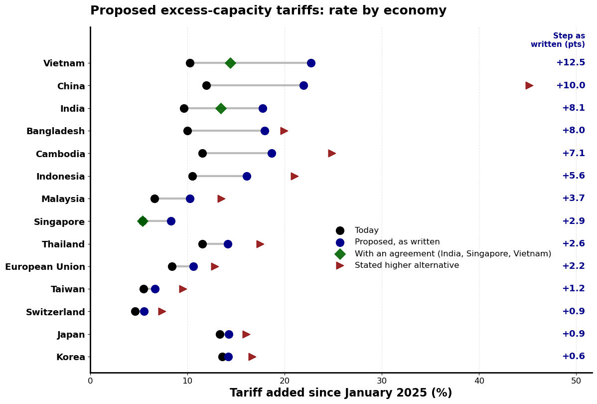

# Proposed Section 301 tariffs on structural excess capacity

*Memo, November 25, 2026. Rates are from the tracker's engine: statutory, weighted by 2024
imports, evaluated at today's rates (latest policy date Oct 30, 2026).*

**Bottom line.** USTR has proposed, but not imposed, new Section 301 tariffs on 14
economies. If they took effect as written, the average U.S. tariff would rise from 11.5% to
14.4%, about where it stood before the Supreme Court ended the IEEPA tariffs. To show where
rates are headed, the tracker's published series now includes the proposals from an assumed
date, Feb 1, 2027. Nothing before that date changes.

## 1. What the action is

- **Status.** On Nov 25, 2026 USTR found the practices of 14 economies actionable under
  Section 301(b) and proposed tariffs on each. The investigations began Mar 11, 2026 and
  cover structural excess capacity and production in manufacturing. USTR made no
  determination for Mexico or Norway.
- **A cap, not an add-on.** Each notice proposes a tariff "up to" a rate on all goods of
  the economy, "net of existing Section 301 tariffs". The forced-labor duty in force since
  Jul 24, 2026 counts toward the rate, so the proposal raises each economy's all-in
  Section 301 rate to a cap. For the EU, Japan, Korea, Switzerland and Taiwan the cap also
  includes the ordinary (MFN) duty.
- **Exemptions.** Section 232 goods are exempt, as is a list of about 2,100 products: the
  forced-labor duty's exemption list plus 8 codes. Seven economies get further
  country-specific exemptions.
- **China is treated differently.** Its cap is 20%. The goods on the product list are not
  exempt; they pay up to 10%. The 77 products of the U.S.-China "30-for-30" list are
  exempt. And the China notice, unlike the other 13, does not exempt Section 232 goods.
- **Timing.** Comments are due Jan 5, 2027 and the hearing is Jan 25, 2027. No effective
  date is proposed.

| Economy | All-in 301 rate now | Proposed | Other rate in the notice |
|---|---|---|---|
| EU | 10%, incl. MFN | 15%, incl. MFN | 20% if consultations fail |
| Japan, Switzerland | 12.5%, incl. MFN | 15%, incl. MFN | 20% if consultations fail |
| Korea | 12.5% | 15%, incl. MFN | 25% if consultations fail |
| Taiwan | 10%, incl. MFN | 15%, incl. MFN | 25% if consultations fail |
| Bangladesh | 10% | 18% | 20% if consultations fail |
| Cambodia, Indonesia, Malaysia | 10% | 18% | 25% if consultations fail |
| Thailand | 12.5% | 18% | 25% if consultations fail |
| India | 10% | 25% | 17% with an agreement |
| Singapore | 12.5% | 20% | 10% with an agreement |
| Vietnam | 12.5% | 35% | 20% with an agreement |
| China | 12.5% | 20%; listed goods 10% | 40% on all goods |

The last column runs in two directions. Eleven economies, China included, already have a
trade deal or framework with the United States. Their proposed rate assumes those
commitments hold, and the other rate is the higher one USTR would consider if it finds the
commitments or the ongoing consultations unsatisfactory. India, Singapore and Vietnam are
the reverse: the proposed rate is the rate without a deal, and each notice names a lower
rate USTR would consider if the economy concludes an Agreement on Reciprocal Trade that
responds to the investigation's findings.

## 2. Effect on tariff rates

**In aggregate.** The 14 economies supply 60% of the imports the tracker covers.

| Scenario | Average U.S. tariff | Change |
|---|---|---|
| Today | 11.46% | |
| Proposed, as written | 14.36% | +2.89 points |
| With agreements (India 17%, Singapore 10%, Vietnam 20%) | 13.83% | +2.37 |
| Every stated alternative (China at 40%) | 18.39% | +6.92 |
| Last level under IEEPA (Feb 7, 2026), for reference | 14.28% | |

**By economy, as written.** Rates are the tariff added since January 2025.

| Economy | 2024 imports ($B) | Rate now | Rate proposed | Step (points) | Share of the national step (points) |
|---|---:|---:|---:|---:|---:|
| Vietnam | 141 | 10.3% | 22.7% | +12.5 | 0.55 |
| China | 429 | 11.9% | 22.0% | +10.0 | 1.34 |
| India | 88 | 9.7% | 17.7% | +8.1 | 0.22 |
| Bangladesh | 8 | 10.0% | 18.0% | +8.0 | 0.02 |
| Cambodia | 13 | 11.6% | 18.7% | +7.1 | 0.03 |
| Indonesia | 28 | 10.5% | 16.1% | +5.6 | 0.05 |
| Malaysia | 52 | 6.6% | 10.3% | +3.7 | 0.06 |
| Singapore | 43 | 5.4% | 8.3% | +2.9 | 0.04 |
| Thailand | 63 | 11.5% | 14.1% | +2.6 | 0.05 |
| European Union | 597 | 8.4% | 10.6% | +2.2 | 0.41 |
| Taiwan | 115 | 5.5% | 6.7% | +1.2 | 0.04 |
| Switzerland | 61 | 4.6% | 5.5% | +0.9 | 0.02 |
| Japan | 151 | 13.3% | 14.2% | +0.9 | 0.04 |
| Korea | 130 | 13.6% | 14.2% | +0.6 | 0.02 |

- **Three economies carry the result.** China, Vietnam and the EU account for 2.3 of the
  2.9 points.
- **The deal economies move little.** For the EU, Japan, Korea, Switzerland and Taiwan the
  cap rises only from 10% or 12.5% to 15%, and much of their trade is already under
  Section 232 or exempt.
- **Agreements matter most for Vietnam and India.** With them, Vietnam's step is +4.2
  points instead of +12.5 and India's +3.8 instead of +8.1, which returns both to about
  their February 2026 rates. Singapore's step would be zero.
- **The proposal largely restores the IEEPA-era rates.** For ten of the 14, the proposed
  rate is within about 2 points of the Feb 7, 2026 rate. As written, Vietnam (+8.3), India
  (+4.2), Singapore (+4.1) and China (+2.5) would sit above it.

## 3. Open issues

**Questions only the final notices can settle**

1. **The rates.** Every rate is a ceiling. The scenarios above span +2.4 to +6.9 points.
2. **China's Section 232 goods.** Read as written, the China duty applies to steel,
   aluminum, autos and other Section 232 goods, 19% of Chinese imports. If the final notice
   exempts them, as it does for the other 13, China's step is +6.2 instead of +10.0 and the
   national step +2.4 instead of +2.9. This is the largest single uncertainty.
3. **Timing.** The action cannot precede the Jan 25, 2027 hearing, and no notice proposes
   a date. The series assumes Feb 1, 2027. If USTR has not acted as that date approaches,
   the assumed date has to be moved before it arrives. One scheduled step lands first: the
   Jan 1, 2027 increase in the Section 232 rates on furniture and cabinets (+0.04 points).
4. **Mexico and Norway.** No determination yet.
5. **Two unclear clauses.** Korea's notice says "net of MFN", but the model treats Korea as
   flat, as it does for the forced-labor duty (0.01 points nationally). The EU notice
   proposes that "this adjustment terminate on December 1, 2028" without saying what
   follows; the model does not act on it.

**Limits of the model**

6. **A projection in the published series.** From Feb 1, 2027 the series carries the
   proposals as written (14.39%, against 11.50% in January). Those rows are the tracker's
   assumption, not law. When the final notices publish, their rates and dates replace the
   assumed ones, after a diff of the final notices against the proposal.
7. **Indonesia.** Palm oil is exempt from the new duty in the model, but still pays the
   10% forced-labor duty it is legally exempt from. That existing overstatement, 0.9
   points on Indonesia, is unchanged.
8. **Unidentified Section 232 sectors.** Medium and heavy vehicles, semiconductors and
   patented pharmaceuticals are exempt, but the model cannot identify them, so they take
   the new duty. The higher caps make this overstatement larger. It is not quantified.
9. **A gap in the forced-labor list.** Seven 10-digit products that the forced-labor
   notice exempts are missing from its list ($0.3B of imports, about 0.001 points). Logged,
   not corrected.

**Where things are.** The analysis is in
[code/analysis/section301-secp-overview.ipynb](code/analysis/section301-secp-overview.ipynb);
the method and the checklist for the final notices are in
[METHODOLOGY.md](METHODOLOGY.md#proposed--section-301-structural-excess-capacity-in-the-series-from-an-assumed-date).
Both published data files carry the proposals from Feb 1, 2027; every earlier row is
unchanged.
